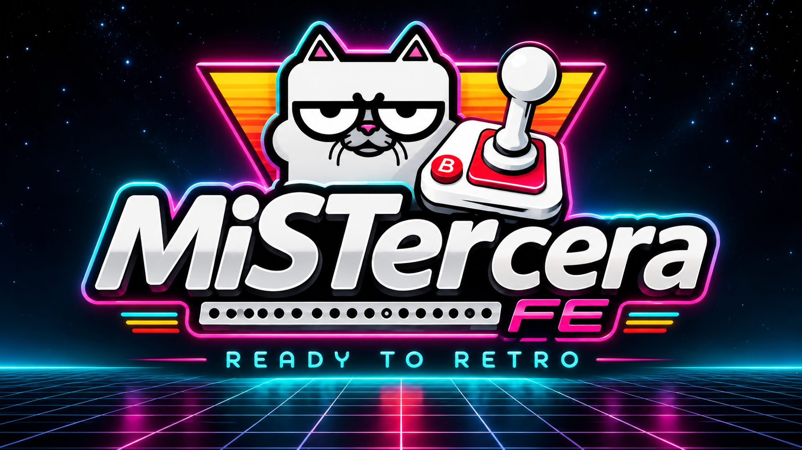
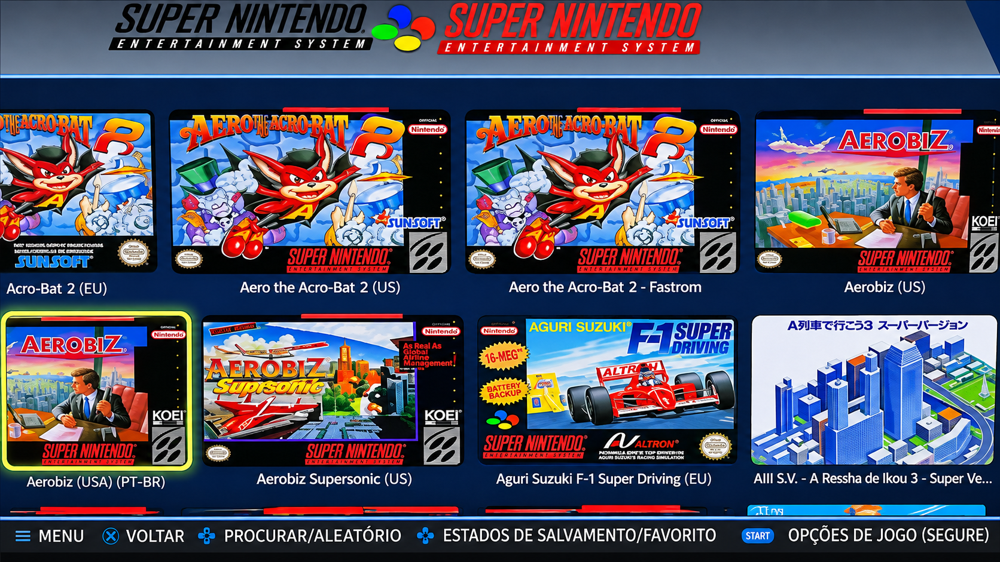

<p align="center"></p>

# Mistercera FE — Batocera's EmulationStation on the MiSTer FPGA

Batocera's EmulationStation frontend, with the Carbon theme, running on the
MiSTer/DE10-Nano's ARM: drawn in software (the MiSTer has no GPU) on the Linux
framebuffer. Pick a game, play it on its MiSTer core, and come back to the
frontend. Two versions are published:

- **Mistercera FE** (latest release: [0.10 beta 6](https://github.com/MisterTemaki/es-mister/releases/latest)):
  draws at 1280×720 and fills a 1080p screen. This is the version to use. Its
  sources are the [`audit-2026-11-16`](https://github.com/MisterTemaki/es-mister/tree/audit-2026-11-16) branch.
  It was called ES-MiSTer 720p up to 0.10 beta 5.
- **ES-MiSTer 1080p** (release `mister-1080p-20261115`, this branch): an
  experimental 1920×1080 version, very slow (about 80 ms a whole frame), kept
  for tests.

## Mistercera FE

<p align="center"></p>
<p align="center"><sub>The Super Nintendo's games with their covers (Carbon theme, menu in Portuguese).</sub></p>

[Download the latest release](https://github.com/MisterTemaki/es-mister/releases/latest)
(`Mistercera_FE-0.10-beta6.zip`).

1. Extract the ZIP at the root of the MiSTer's SD card. You get
   `/media/fat/mistercera_fe/` and `/media/fat/Scripts/Mistercera_FE.sh`;
   nothing else on the card is touched.
2. Keep `fb_terminal=1` in `MiSTer.ini` (it is the default).
3. In the MiSTer menu: **Scripts > Mistercera_FE**. The MiSTer menu goes away
   at once, the logo shows while the frontend loads, and the systems come a
   few seconds later.
4. **Covers:** the games show without covers at first. With the MiSTer on the
   network, stay on the systems screen, open the menu (Select on a controller,
   Space on the keyboard) > **Scraper**, leave the defaults (Libretro-thumbnails:
   no account or key) and choose **Scrape now**. Games are recognised by their
   ROM's CRC32 or their file name, so any naming works.

Room on the SD card: about 100 MB, plus about 0.6 GB for every 1,000 games once
their covers are downloaded.

**Updating from 0.10 beta 5 or earlier** (the folder `es-mister-720p`): first
rename `/media/fat/es-mister-720p` to `/media/fat/mistercera_fe` (the
frontend's settings and caches stay), then extract the ZIP and delete the old
`Scripts/es-mister-720p.sh`. Extracting always replaces
`mistercera_fe/es-mister.ini` with the default settings: save yours first if
you changed it.

What it does:

- **Full screen at 1280×720** with the MiSTer's own output and `MiSTer.ini`
  left as they are: the frontend enlarges its frames 1.5 times as it copies
  them to a 1080p framebuffer.
- **Games on their MiSTer cores:** a game starts at once; hold **Create +
  Options** for a second (Share + Options on a DualShock 4) to come back to the
  frontend. The controller's MiSTer menu button (the DualSense's PS) asks
  before leaving for the MiSTer menu.
- **Games in the MiSTer's usual folders** (`games/NES`, `games/SNES`,
  `games/MegaDrive`, …; arcade in `_Arcade`; the Sharp X68000 as the MGL files
  in `_Computer/_X68000 Games`).
- **Covers without an account or a key** (Libretro-thumbnails, with Hasheous
  and TheGamesDB for the rest), kept decoded in a cache so that a cover seen
  before comes back about 20 times faster.
- **The processor for the frontend:** the MiSTer BGM and Zaparoo are closed
  while it runs and started again when it closes; the arcade sound server is
  paused (`STOP_SERVICES` in `es-mister.ini`).
- Opens in English; the language is in Menu > System settings > Language.

`README.txt` in the folder covers using it, the covers, the settings and what
to do if something goes wrong; the [release notes](https://github.com/MisterTemaki/es-mister/releases)
list what changed in each version.

### Building Mistercera FE

On Linux with Git, CMake, Ninja, Python 3, autoconf, automake, libtool and gettext:

```bash
git clone --recurse-submodules -b audit-2026-11-16 https://github.com/MisterTemaki/es-mister.git
cd es-mister
python3 -m venv .venv
. .venv/bin/activate
python3 -m pip install ziglang==0.17.1
export MISTER_WORK=/path/to/es-mister-cache
bash mister/build.sh deps
bash mister/build.sh es
ES_SIZE=1280x720 ES_NAME=mistercera_fe ES_SCRIPT=Mistercera_FE ES_TITLE="Mistercera FE" \
  ES_VERSION="0.10 beta 6" ES_ZIP=Mistercera_FE-0.10-beta6 bash mister/package.sh
```

The ZIP ends up in `$MISTER_WORK/dist/`.

## ES-MiSTer 1080p — Carbon in Full HD

**1920×1080** output and software rendering. This version keeps Carbon's
appearance, filtering, transparencies, layers, transition durations and controls.
It keeps two drawing threads, bands of 8 rows and a 256-byte prefetch.

### Version validated on 15/11/2026

[Download the release with sources, update and evidence](https://github.com/MisterTemaki/es-mister/releases/tag/mister-1080p-20261115).

Measurements on the MiSTer itself, alternating the already optimised reference and the final
version, on the same catalogue/Carbon/1080p: **4,000 of 4,000 commands answered**.
The values below are medians of two rounds per version.

| Metric | Reference | Final version |
|---|---:|---:|
| SDL queue → first redraw, median | 98.300 ms | 95.500 ms |
| p95 per round | 139.105 ms | 130.149 ms |
| p99 per round | 174.888 ms | 152.034 ms |
| Renderer execution, median | 81.697 ms | 78.059 ms |

**16.7 ms was not reached.** FPS=60 is the configured ceiling. The worst command
observed went from 210.078 to 230.190 ms; the reports also show
the performance trade-offs with covers and the limits of the measurements. These times
end at the software's write, without measuring the physical controller, scanout or TV.

The accepted ARM binary has SHA-256
`872dd340826f39da1bb14371681bb0decc4f4d3c640ae93e646ef46337465b55`.
The C++ sources and headers published match that build's manifest.
The release's ZIPs keep the delivery's original artefacts; the Git tree
adds this documentation and the reproduction scripts.

- [Final results and regressions](audit/performance-1080p/CLOSING.md)
- [Limits found and why there is still latency](audit/performance-1080p/LIMITS.md)
- [Complete build and reproduction](audit/performance-1080p/REPRODUCE.md)
- [Linux investigation](audit/performance-1080p/LINUX.md)
- [The delivery's summaries and hashes](audit/performance-1080p/final-delivery/)
- [Preparing the validation scripts](validation/README.md)

### Building the 1080p ARM binary

On Linux with Git, CMake, Ninja, Python 3, autoconf, automake, libtool and gettext:

```bash
git clone --recurse-submodules https://github.com/MisterTemaki/es-mister.git
cd es-mister
python3 -m venv .venv
. .venv/bin/activate
python3 -m pip install ziglang==0.15.2
export MISTER_WORK=/path/to/es-mister-cache
export JOBS=6
bash mister/build.sh deps
bash mister/build.sh es
```

The ELF ends up in `$MISTER_WORK/out/emulationstation`. See the complete guide
for host dependencies, comparison with the reference and installation. The
release's update uses the Carbon theme already installed; it is not a full
image of the SD card.

### Installing the validated update

Extract the release's update ZIP and read the included `LEIA-ME.txt` (the
notes, written in Portuguese at the time; [`mister/README.txt`](mister/README.txt)
is the English version) before running `install-update.py`. The installer checks
hashes, keeps a backup and checks readiness; it keeps existing settings. No SSH key,
commercial ROM or build cache is part of the packages.

The repository's earlier history and the credits/licences were preserved.
EmulationStation's original documentation follows.

---

EmulationStation
================

EmulationStation is a cross-platform graphical front-end for emulators with controller navigation.

Building
========

EmulationStation uses some C++11 code, which means you'll need to use at least g++-4.7 on Linux, or Visual Studio 2015 on Windows, to compile.

EmulationStation has a few dependencies. For building, you'll need CMake, SDL2, FreeImage, FreeType, cURL, RapidJSON, LibVLC, SDLMixer.  You also should probably install the `fonts-droid` package which contains fallback fonts for Chinese/Japanese/Korean characters, but ES will still work fine without it (this package is only used at run-time). Your distro may also offer a "system developer" group of packages that includes essential compilation tools, it is recommended to install that first.

**On Debian/Ubuntu:**
All of this can be easily installed with `apt-get`:
```bash
sudo apt-get install libsdl2-dev libsdl2-mixer-dev libfreeimage-dev libfreetype6-dev \
  libcurl4-openssl-dev rapidjson-dev libasound2-dev libgl1-mesa-dev build-essential \
  libboost-all-dev cmake fonts-droid-fallback libvlc-dev libvlccore-dev vlc-bin libint-dev gettext
```
**On Fedora:**
All of this can be easily installed with `dnf` (with rpmfusion activated) :
```bash
sudo dnf install SDL2-devel freeimage-devel freetype-devel curl-devel \
  alsa-lib-devel mesa-libGL-devel cmake \
  vlc-devel rapidjson-devel
```
**On Arch/Manjaro:**
All of this can be easily installed with `pacman`:
```bash
sudo pacman -S base-devel cmake freeimage sdl2_mixer sdl2 rapidjson boost
```
**On Solus:**
All of this can be easily installed with `eopkg`:
```bash
sudo eopkg it -c system.devel sdl2-devel freeimage-devel freetype2-devel curl-devel \
  rapidjson-devel alsa-lib-devel mesalib-devel vlc-devel sdl2-mixer-devel \
  libcec-devel
```

Note this Repository uses a git submodule - to checkout the source and all submodules, use

```bash
git clone --recursive https://github.com/batocera-linux/batocera-emulationstation.git
```

or

```bash
git clone https://github.com/batocera-linux/batocera-emulationstation.git
cd batocera-emulationstation
git submodule update --init
```

To setup compilation, generate and build the Makefile with CMake:
```bash
cmake .
```

And then begin compilation:
```bash
make
```

**On the Raspberry Pi:**

Every model from the Pi 1 onwards is supported, but the graphics API to build against depends
on the GPU:

| Model | GPU | Max OpenGL ES | Configure with |
| --- | --- | --- | --- |
| Pi 1, Pi 2, Pi 3, Zero, Zero 2 W | VideoCore IV | 2.0 | `cmake -DGLES2=ON .` |
| Pi 4, Pi 400, CM4 | VideoCore VI | 3.1 | `cmake -DGLES3=ON .` |
| Pi 5, CM5 | VideoCore VII | 3.1 | `cmake -DGLES3=ON .` |

`-DGLES3=ON` selects the OpenGL ES 3.x renderer, which is the faster of the two backends. It
requires a driver that can create an ES 3.x context, so it is only suitable for the Pi 4 and
later.

Running plain `cmake .` is also fine: with no graphics option set the build detects GLES and
defaults to the OpenGL ES 2.0 renderer, which works on every model. Pass `-DGLES3=ON`
explicitly on a Pi 4 or later to get the faster path.

**On Windows:**

[FreeImage](http://downloads.sourceforge.net/freeimage/FreeImage3154Win32.zip)

[FreeType2](http://download.savannah.gnu.org/releases/freetype/freetype-2.4.9.tar.bz2) (you'll need to compile)

[SDL2](http://www.libsdl.org/release/SDL2-devel-2.0.8-VC.zip)

[cURL](http://curl.haxx.se/download.html) (you'll need to compile or get the pre-compiled DLL version)

[RapisJSON](https://github.com/tencent/rapidjson) (you'll need the `include/rapidsjon` added to the include path)

[SDL Mixer](https://www.libsdl.org/projects/SDL_mixer/)

[LibVlc](http://download.videolan.org/pub/videolan/vlc/) (x86 sdk files are present in .7z files)

[CMake](http://www.cmake.org/cmake/resources/software.html) (this is used for generating the Visual Studio project)

```
set ES_LIB_DIR=c:\src\lib

mkdir c:\src\batocera-emulationstation\build
cd c:\src\batocera-emulationstation\build /D

cmake -g "Visual Studio 14 2015 x86" .. -DEIGEN3_INCLUDE_DIR=%ES_LIB_DIR%\eigen -DRAPIDJSON_INCLUDE_DIRS=%ES_LIB_DIR%\rapidjson\include -DFREETYPE_INCLUDE_DIRS=%ES_LIB_DIR%\freetype-2.7\include -DFREETYPE_LIBRARY=%ES_LIB_DIR%\freetype-2.7\objs\vc2010\Win32\freetype27.lib -DFreeImage_INCLUDE_DIR=%ES_LIB_DIR%\FreeImage\Source -DFreeImage_LIBRARY=%ES_LIB_DIR%\FreeImage\Dist\x32\FreeImage.lib -DSDL2_INCLUDE_DIR=%ES_LIB_DIR%\SDL2-2.0.9\include -DSDL2_LIBRARY=%ES_LIB_DIR%\SDL2-2.0.9\build\Release\SDL2.lib;%ES_LIB_DIR%\SDL2-2.0.9\build\Release\SDL2main.lib;Imm32.lib;version.lib -DBOOST_ROOT=%ES_LIB_DIR%\boost_1_61_0 -DBoost_LIBRARY_DIR=%ES_LIB_DIR%\boost_1_61_0\lib32-msvc-14.0 -DCURL_INCLUDE_DIR=%ES_LIB_DIR%\curl-7.50.3\include -DCURL_LIBRARY=%ES_LIB_DIR%\curl-7.50.3\builds\libcurl-vc14-x86-release-dll-ipv6-sspi-winssl\lib\libcurl.lib -DVLC_INCLUDE_DIR=%ES_LIB_DIR%\libvlc-2.2.2\include -DVLC_LIBRARIES=%ES_LIB_DIR%\libvlc-2.2.2\lib\msvc\libvlc.lib;%ES_LIB_DIR%\libvlc-2.2.2\lib\msvc\libvlccore.lib -DVLC_VERSION=1.0.0 -DSDLMIXER_INCLUDE_DIR=%ES_LIB_DIR%\SDL2_mixer-2.0.4\include -DSDLMIXER_LIBRARY=%ES_LIB_DIR%\SDL2_mixer-2.0.4\lib\x86\SDL2_mixer.lib
```

Launching outside of Batocera
=============================

To launch Batocera EmulationStation, it is recommended to build it with [batocera.linux](https://github.com/batocera-linux/batocera.linux) instead. However, you can run a barebones version of ES (perhaps you want to tweak some menus without waiting for the entirety of Batocera to compile) if you provide the appropriate folder structure and files for it. **If you launch Batocera EmulationStation this way outside of Batocera, expect a lot of things to not actually be functional (eg. emulator launching, the background music player, the webserver, etc.), such things can only work with an environment set up identically to Batocera.** Before attempting this, it is recommended to have built batocera.linux at least once to have the appropriate configuration files for Batocera Emulationstation. They can also conveniently be taken from an existing Batocera install, from the same paths relative to root being `target`. For example: `/usr/share/emulationstation/`

Create the appropriate directories for ES's configuration files and resources, then copy them in from Batocera (instructions assuming you've already built batocera.linux):

```bash
sudo mkdir /etc/emulationstation
sudo chmod a+w /etc/emulationstation
cp -r ~/batocera.linux/output/x86_64/target/usr/share/emulationstation/ /etc/
```

(This would be where `/usr/share/emulationstation/` is used instead if copying from an existing Batocera install).

Then create the `/userdata` directory in your root, give it the correct permissions, and copy in the data from Batocera's `datainit` folder:

```bash
sudo mkdir /userdata
sudo chmod a+w /userdata
cp -r ~/batocera.linux/output/x86_64/target/usr/share/batocera/datainit/* /userdata
```

Then run `./emulationstation.sh` to start up EmulationStation. This will give you enough to navigate menus and change settings, however since we aren't truly inside of Batocera you'll find that none of the emulators launch and none of the secondary functions (such as the background music player) work.

If you want to see the full Batocera EmulationStation experience, it is recommended to build [batocera.linux](https://github.com/batocera-linux/batocera.linux) instead.

Configuring
===========

**~/.emulationstation/es_systems.cfg:**
When first run, an example systems configuration file will be created at `~/.emulationstation/es_systems.cfg`.  `~` is `$HOME` on Linux, and `%HOMEPATH%` on Windows.  This example has some comments explaining how to write the configuration file. See the "Writing an es_systems.cfg" section for more information.

**Keep in mind you'll have to set up your emulator separately from EmulationStation if not launching from within Batocera!**

**~/.emulationstation/es_input.cfg:**
When you first start EmulationStation, you will be prompted to configure an input device. The process is thus:

1. Hold a button on the device you want to configure.  This includes the keyboard.

2. Press the buttons as they appear in the list.  Some inputs can be skipped by holding any button down for a few seconds.

3. You can review your mappings by pressing up and down, making any changes by pressing South (B on SNES).

4. Choose "SAVE" to save this device and close the input configuration screen.

The new configuration will be added to the `/etc/emulationstation/es_input.cfg` file.

**Both new and old devices can be (re)configured at any time by pressing the Start button and choosing "MAP CONTROLLER".** From here, you may unplug the device you used to open the menu and plug in a new one, if necessary. New devices will be appended to the existing input configuration file, so your old devices will remain configured.

**If your controller stops working, you can delete the `~/.emulationstation/es_input.cfg` file to make the input configuration screen re-appear on next run.**

You can use `--help` or `-h` to view a list of command-line options. Briefly outlined here:
```
--resolution [width] [height]   try and force a particular resolution
--gamelist-only                 skip automatic game search, only read from gamelist.xml
--ignore-gamelist               ignore the gamelist (useful for troubleshooting)
--draw-framerate                display the framerate
--no-exit                       don't show the exit option in the menu
--no-splash                     don't show the splash screen
--debug                         more logging, show console on Windows
--scrape                        scrape using command line interface
--windowed                      not fullscreen, should be used with --resolution
--fullscreen-borderless			fullscreen, non exclusive.
--vsync [1/on or 0/off]         turn vsync on or off (default is on)
--max-vram [size]               Max VRAM to use in Mb before swapping. 0 for unlimited
--force-kid             		Force the UI mode to be Kid
--force-kiosk           		Force the UI mode to be Kiosk
--force-disable-filters         Force the UI to ignore applied filters in gamelist
--home							Force the .emulationstation folder (windows)
--help, -h                      summon a sentient, angry tuba
```

As long as ES hasn't frozen, you can always press F4 to close the application.

Writing an es_systems.cfg
=========================

Complete configuration instructions at [emulationstation.org](http://emulationstation.org/gettingstarted.html#config).

The `es_systems.cfg` file contains the system configuration data for EmulationStation, written in XML.  This tells EmulationStation what systems you have, what platform they correspond to (for scraping), and where the games are located.

ES will check the following location for its `es_systems.cfg` file:
* `/etc/emulationstation/es_systems.cfg`

The order EmulationStation displays systems reflects the order you define them in.

**NOTE:** A system *must* have at least one game present in its "path" directory, or ES will ignore it! If no valid systems are found, ES will report an error and quit!

See [SYSTEMS.md](SYSTEMS.md) for some live examples in EmulationStation.

The following "tags" are replaced by ES in launch commands:

`%ROM%`		- Replaced with absolute path to the selected ROM, with most Bash special characters escaped with a backslash.

`%BASENAME%`	- Replaced with the "base" name of the path to the selected ROM. For example, a path of "/foo/bar.rom", this tag would be "bar". This tag is useful for setting up AdvanceMAME.

`%ROM_RAW%`	- Replaced with the unescaped, absolute path to the selected ROM.  If your emulator is picky about paths, you might want to use this instead of %ROM%, but enclosed in quotes.

`%HOME%`	- Replaced with the home folder.

`%SYSTEM%`	- Replaced with the current selected system name.

`%EMULATOR%`	- Replaced with the current selected emulator.

`%CORE%`	- Replaced with the current selected core.

gamelist.xml
============

The `gamelist.xml` file for a system defines metadata for games, such as a name, image (like a screenshot or box art), description, release date, and rating.

If at least one game in a system has an image specified, ES will use the detailed view for that system (which displays metadata alongside the game list).

*You can use ES's [scraping](http://en.wikipedia.org/wiki/Web_scraping) tools to avoid creating a `gamelist.xml` by hand.*  There are two ways to run the scraper:

* **If you want to scrape multiple games:** press start to open the menu and choose the "SCRAPER" option.  Adjust your settings and press "SCRAPE NOW".
* **If you just want to scrape one game:** find the game on the game list in ES and press select.  Choose "EDIT THIS GAME'S METADATA" and then press the "SCRAPE" button at the bottom of the metadata editor.

You can also edit metadata within ES by using the metadata editor - just find the game you wish to edit on the gamelist, press Select, and choose "EDIT THIS GAME'S METADATA."

A command-line version of the scraper is also provided - just run emulationstation with `--scrape` *(currently broken)*.

The switch `--ignore-gamelist` can be used to ignore the gamelist and force ES to use the non-detailed view.

If you're writing a tool to generate or parse gamelist.xml files, you should check out [GAMELISTS.md](GAMELISTS.md) for more detailed documentation.


Themes
======

By default, EmulationStation will use ES-Carbon. Additional themes can be installed into `/etc/emulationstation/themes`.

If you want to know more about making your own themes (or editing existing ones), read [THEMES.md](THEMES.md) or check out the [wiki page](https://wiki.batocera.org/write_themes_for_emulationstation).

